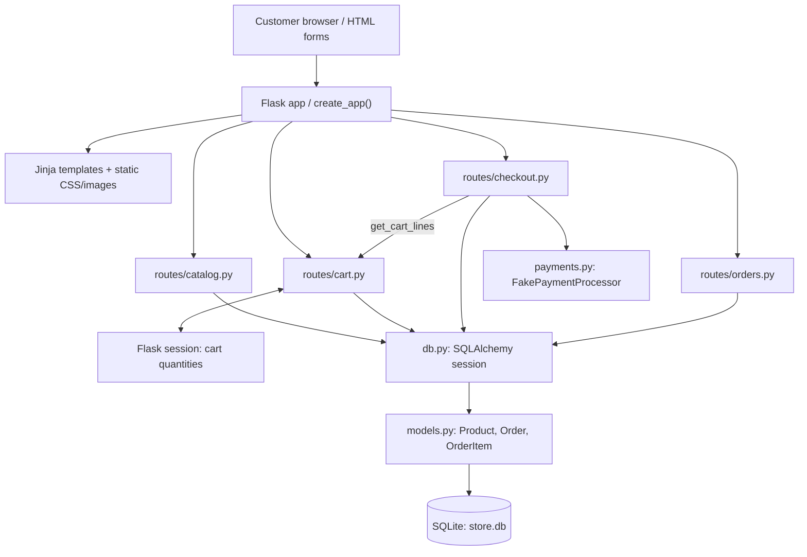

# Milestone 1 — Understand & Establish the Baseline

> Understand before you redesign.

## 1. Team & Store

- **Team members (5):**
  1. De los Reyes Renteria, Paulina
  2. Hernandez Flores, Daniel Emiliano
  3. Huerta Vasquez, Andres
  4. Orozco Miranda, Sergio Lavin
  5. Renteria Mendez, Emilio Ismael
- **Store name:** Trendify.
- **Store vertical / concept:** Trendify — clothing and apparel e-commerce store.
- **Repository:** https://github.com/SergioABC123/commerce-evolution-starter-ropa
- **Short product description:** Trendify is an online clothing storefront in which customers browse apparel, view product details, add items to a shopping cart, and place orders through a simulated checkout. The team will customize the brand, clothing catalog, imagery, and visual presentation while preserving the existing purchase behavior.

## 2. Baseline Validation

The initial application was validated **before storefront customization**. The following observations reflect the team's local verification and the public GitHub Actions result:

- [x] **Application runs from a local setup.** The virtual environment and dependencies were configured, the database was seeded, and Flask served the storefront successfully (HTTP 200).
- [x] **Existing automated tests pass locally.** `python -m pytest` reported **12 passed**.
- [x] **GitHub Actions CI passes for the baseline.** The repository's initial `tests #1` run completed successfully on November 13, 2026; see the [Actions page](https://github.com/SergioABC123/commerce-evolution-starter-ropa/actions).
- [x] **End-to-end purchase works.** The catalog, product selection, cart, checkout with `tok_success`, order confirmation, and order history were tested locally.
- [x] **Orders and inventory persist.** After a completed purchase, order information and reduced stock remained after restarting the Flask application. The existing automated suite also checks persisted order items and inventory changes.

**Evidence:** Local storefront, successful checkout, order history/inventory after restart, local pytest output, and successful GitHub Actions screenshots are retained for `milestone-1-evidence.pdf`.

- [x] **Final integration checkpoint:** Re-run `python -m pytest` (12/12 passed), verified the complete purchase flow end-to-end, confirmed SQLite inventory decrement (15 -> 14), and validated that all customized streetwear products and imagery render smoothly. Verified by Andrés Huerta on November 13, 2026.

## 3. Current System Design

The diagram represents the **existing starter architecture**, not a proposed redesign. Flask registers four route Blueprints. Jinja templates render the interface; the cart is stored in the Flask session; SQLAlchemy manages persistent products, orders, order items, and stock through SQLite; checkout calls a simulated payment processor.

The diagram groups model mappings and database access for readability; `models.py` defines the mappings, while `db.py` configures the SQLAlchemy engine and request-scoped session. There is no separate service or repository layer in the starter.

## 4. Responsibilities & Dependencies

| Part / module | Main responsibility | Important dependencies |
| --- | --- | --- |
| `src/store/__init__.py` | Creates and configures the Flask application, initializes the database, registers Blueprints, and defines the money template filter. | Flask, `db.py`, the four route modules. |
| `routes/catalog.py` | Lists active products and displays individual product pages. | `Product`, `get_session()`, Jinja templates. |
| `routes/cart.py` | Adds, updates, removes, and displays cart items; builds `CartLine` objects and calculates line totals. | Flask `session`, `Product`, `get_session()`, Jinja templates. |
| `routes/checkout.py` | Validates checkout input and stock, calculates shipping/total, calls payment, creates the order and items, decrements stock, commits changes, and clears the cart. | `get_cart_lines()`, `FakePaymentProcessor`, `Order`, `OrderItem`, `get_session()`, Flask `session`. |
| `routes/orders.py` | Displays order history and details of a saved order. | `Order`, `get_session()`, Jinja templates. |
| `payments.py` | Simulates payment authorization; returns a payment reference or raises `PaymentDeclined`. | No external payment API; Python standard library. |
| `models.py` | Defines persistent `Product`, `Order`, and `OrderItem` mappings, including order-item relationships and inventory fields. | SQLAlchemy, `db.Base`. |
| `db.py` | Sets up the SQLite SQLAlchemy engine, creates tables, provides a session per application context, and closes it on teardown. | Flask, SQLAlchemy, SQLite. |
| `templates/`, `static/` | Renders storefront pages and supplies styling/product imagery. | Flask/Jinja data supplied by routes, browser. |
| `seed.py`, `tests/`, `.github/workflows/tests.yml` | Populate baseline products, verify behavior, and run pytest automatically in CI. | App factory, SQLAlchemy, pytest, GitHub Actions. |

### Purchase flow (existing behavior)

1. A customer views a product through `catalog.py` and adds it to the cart using a POST route in `cart.py`.
2. The cart stores product IDs and quantities in the Flask session. `get_cart_lines()` resolves those IDs against current `Product` records in the database.
3. A GET request to `/checkout` shows the selected products, subtotal, fixed standard shipping charge, and total.
4. A POST request to `/checkout` validates customer/shipping fields and the payment token, then checks available stock for each cart line.
5. `checkout.py` calculates the total and calls `FakePaymentProcessor().charge()`. A declined payment redirects the user without creating an order.
6. On success, checkout creates an `Order`, flushes it to obtain its ID, adds `OrderItem` records with product information, and decreases each purchased product's `stock_quantity`.
7. `db.commit()` persists the order, order items, and inventory changes together in SQLite. Checkout then clears the session cart and redirects to the order detail page.
8. `orders.py` reads the persisted order and related items for confirmation and order history views.

## 5. Design Observations

**1. Strength — route responsibilities are already localized.** The four Flask Blueprints separate browsing, cart operations, checkout, and order presentation. This keeps the small application navigable and is an appropriate starting point for analyzing the existing behavior. **Evidence:** `src/store/__init__.py` and `src/store/routes/`.

**2. Reasonable original decision — simple infrastructure fits the baseline.** SQLite, SQLAlchemy, a Flask session cart, a single fixed shipping price, and the fake payment processor support a small working store without requiring a real payment gateway or more infrastructure. These are understandable tradeoffs for the current requirements, not defects that M1 must fix. **Evidence:** `db.py`, `cart.py`, `checkout.py`, `payments.py`.

**3. Design pressure — checkout owns most purchase coordination.** The `place_order()` function combines form validation, stock checking, price calculation, payment, order creation, and stock updates. This makes the current flow easy to trace, but changes to shipping policies, payments, or ordering rules would likely converge in one module. **Evidence:** `routes/checkout.py`.

**4. Coupling — checkout directly constructs its payment dependency.** The expression `FakePaymentProcessor().charge(...)` means checkout selects the concrete payment implementation itself. This is acceptable with one simulated provider, but adding or switching payment providers could require changes to checkout. The current milestone does not require an abstraction. **Evidence:** `routes/checkout.py`, `payments.py`.

**5. Potential technical debt — stock checks are not an explicit concurrent reservation.** Checkout checks `stock_quantity` and later decrements it in the same request. The code does not show an explicit stock lock, conditional inventory update, or reservation mechanism. Under simultaneous purchases, this may need closer examination to prevent overselling; no concurrency failure has been demonstrated in the baseline. **Evidence:** `routes/checkout.py`. This is an observation for future requirements, not a reason to redesign M1.

**M1 decision:** Preserve the starter's structural design. Only change files necessary for clothing-store identity/catalog customization or for fixing an actual verified defect. Any future redesign must be justified by new requirements and demonstrated problems.

## 6. AI Use

- **Tool:** ChatGPT.
- **Purpose:** Assisted in reviewing existing repository modules, organizing their responsibilities/dependencies, drafting a Mermaid diagram, and formulating evidence-based design observations.
- **Human verification:** The team ran the application, tested the purchase flow and persistence, reviewed the automated test result and GitHub Actions status, and must review the diagram/text against the final repository before merging. AI did not execute the team's local tests or modify the public repository.

---

*Before submitting: verify the final store description, re-run the tests after integration, and ensure `milestone-1-evidence.pdf` contains the actual screenshots and relevant Pull Request evidence.*
