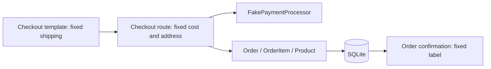
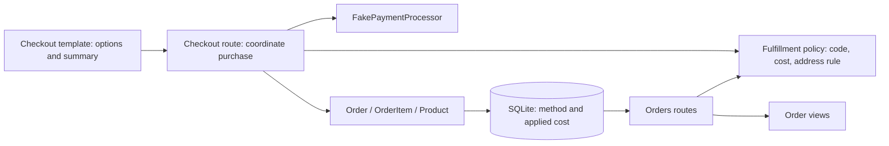

# Milestone 2 — First Evolution | Trendify

Repository: https://github.com/SergioABC123/commerce-evolution-starter-ropa

## Team Members (Equipo 05 — ITESO)
- De los Reyes Renteria, Paulina
- Hernandez Flores, Daniel Emiliano
- Huerta Vasquez, Andres
- Orozco Miranda, Sergio Lavin
- Renteria Mendez, Emilio Ismael

Baseline: `ca7745fdcf1826d8c4485686afb7ff395032f8ed`. The team's local M1 run reported 12 passing tests before changes.

## Change request

| Method | Cost (MXN) | Address required |
|---|---:|---|
| Standard Shipping | $99 | Yes |
| Express Shipping | $199 | Yes |
| Store Pickup | $0 | No |

Persist the selected method and preserve existing checkout, payment, inventory, and order behavior.

## Before: design pressure

`routes/checkout.py` used `STANDARD_SHIPPING_CENTS` in the GET summary and POST payment/order calculation. Its required-fields check always required a shipping address. `checkout.html` and `order_confirmation.html` also assumed standard shipping. `Order` persisted the shipping amount and address but not the method. Adding variants directly in each location would spread pricing and validation rules, risking disagreement between the amount displayed, charged, and stored.

## After: proposed and implemented design

- `store.fulfillment`: immutable option records, a single registry, option lookup and address validation. Prices are expressed in integer cents. It does not depend on Flask, SQLAlchemy, or payment processing.
- `routes/checkout.py`: obtains the selected option, validates customer/address data, checks inventory, computes the server-side total, charges the payment processor, and persists the order and items with the inventory changes. It does not trust client-supplied costs. A missing method defaults to standard for compatibility; an explicit unknown or empty method is rejected.
- `templates/checkout.html`: renders the registry and updates the displayed total and address field using the data supplied by the server. The JavaScript is presentation only; validation and the amount charged are independent of JavaScript.
- `models.py` and `migrations.py`: add a non-null `fulfillment_method` field. M1 orders are classified as `standard` because M1 only supported that method. Existing prices, addresses, references, items and stock remain untouched. Pickup stores an empty address to remain compatible with the existing non-null address column. The additive SQLite migration runs on application initialization and can be repeated safely.
- `routes/orders.py` and order templates: display the persisted method, and use the stored shipping amount rather than the current option price for historical orders.

## Decision and trade-offs

We choose a data-driven fulfillment policy rather than adding a separate Strategy class for each option. The current variants differ only in price and whether an address is required. A new option with those same properties needs a registry entry and focused tests; the checkout, persistence schema and template logic do not need a new branch. The main alternatives were conditionals directly in the checkout (fewer files but rules would spread across the GET/POST paths and views) and Strategy (useful when fulfillment algorithms become distinct, but unnecessary class/selection complexity at this point). If later requirements introduce dynamic quotes, capacity checks, or carrier integrations, this simple policy may need to evolve. The migration is intentionally SQLite-specific and additive; future schema changes may justify a dedicated migration framework. Historical codes and applied costs are stored, but display labels are resolved from the current registry, with the code as a fallback if an option is removed.

## Tests and verification plan

Existing 12 tests are retained unchanged. Additional tests cover rule lookup, address validation, all three purchases with exact charged and persisted totals, inventory and items after reopening the database, invalid methods, failed payments, rendered options, and upgrading a legacy database twice without data loss. Manual browser checks are required for live total updates and the hidden address field when pickup is selected.

### Final observed verification

- **Local tests:** `python -m pytest` completed with **30 passed in 2.82 s** on the team’s updated `main` checkout.
- **Continuous integration:** GitHub Actions shows the successful `tests #35` run after PR #7 was merged into `main`.
- **Workflow:** PRs **#4–#8** (fulfillment policy, persistence/migration, checkout, UI, and integration tests/documentation) were merged. The merged-PR page shows successful checks.
- **Browser validation:** Standard Shipping ($99) requires a nonempty address; leaving it empty triggered the browser’s required-field warning. Express Shipping shows the $199 fee. Store Pickup allowed an empty address, showed $0 shipping, and successfully created order **#6** (Cargo Pants — Asphalt, subtotal and total $799).
- **Persistence after restart:** after restarting the Flask application, order #6 remained visible in the history with **Store Pickup**, and its details still showed a $0 shipping fee and a $799 total. Older orders remained visible as Standard Shipping.
- **Validation distinction:** the browser-level warning was observed manually; server-side rejection is covered by automated tests. The pickup address field may remain visible but is not required.

Screenshots are collected in `milestone-2-evidence.pdf`. These results describe the team’s observed final version, not planned outcomes.

## Meaningful AI use

ChatGPT assisted in inspecting the supplied M1 snapshot, comparing design alternatives, drafting the implementation, tests and documentation. The team is responsible for reviewing the changes, verifying behavior locally and in CI, and reporting actual outcomes. Do not present generated test expectations as observed results.
